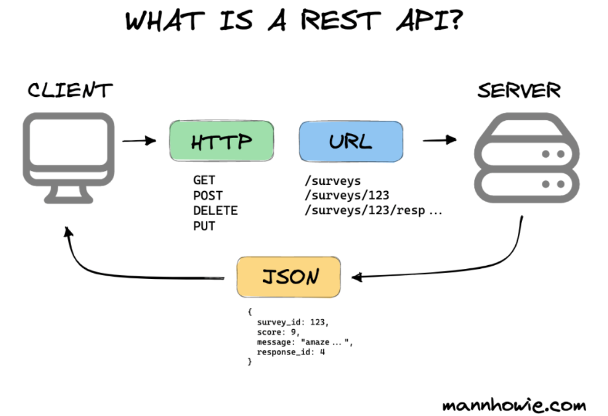

# UT03 - Servicios web con Spring. API Rest

Una **API REST** es una interfaz que permite que distintos sistemas de software se comuniquen entre sí a través de la web siguiendo los principios de la arquitectura REST (Representational State Transfer, o transferencia de estado representacional). Suele utilizar el protocolo HTTP para enviar y recibir datos (a menudo en formato JSON)

## Conceptos teóricos

[Índice de conceptos](./conceptos/readme.md)
- [De MVC a API REST: seguimos con Spring MVC](./conceptos/de-mvc-a-api-rest.md)
- [API REST](./conceptos/API-REST.md)
- [JWT](./conceptos/JWT.md)

## Práctica
[Ejercicios](./ejercicios/readme.md)

___

## Página principal del curso
[VOLVER PÁGINA PRINCIPAL](https://github.com/profeMelola/DWES-00-2026-27)

## Licencia

 Este obra está bajo una <a rel="license" href="http://creativecommons.org/licenses/by-nc-sa/4.0/">licencia de Creative Commons Reconocimiento-NoComercial-CompartirIgual 4.0 Internacional</a>.
