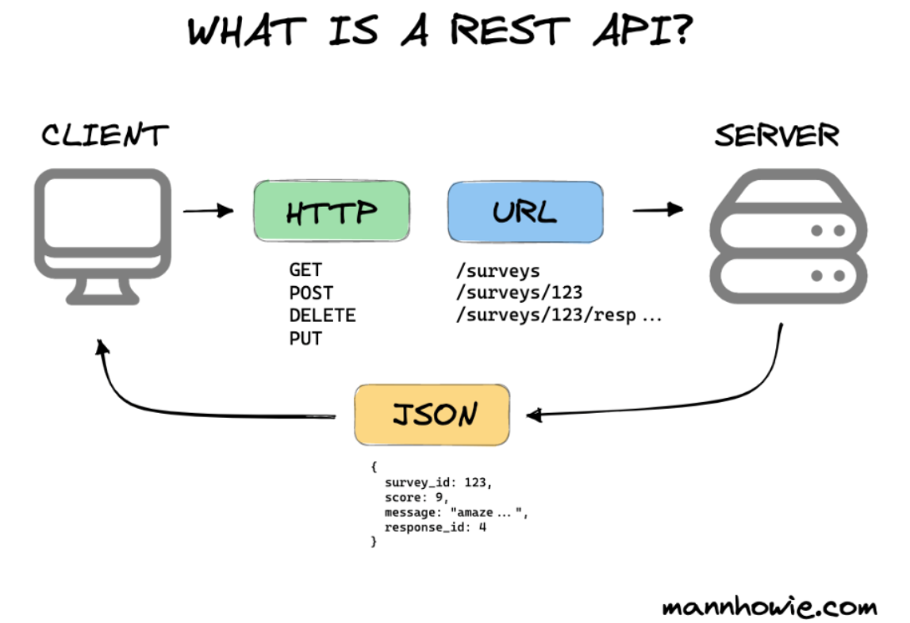

# API REST



Una API REST (Representational State Transfer) es una interfaz que permite la comunicación entre sistemas mediante el protocolo HTTP.

Importancia:

- **Escalabilidad:** las APIs REST son fácilmente escalables porque son stateless (sin estado).
- **Flexibilidad:** admiten distintos formatos de datos (JSON, XML, etc.).
- **Simplicidad:** son fáciles de usar y entender, lo que acelera el desarrollo y el mantenimiento.

> Antes de este documento, lee [De MVC a API REST: seguimos con Spring MVC](de-mvc-a-api-rest.md).

## Reglas básicas para diseñar una API RESTful

| Regla | Qué asegura | En clase |
|---|---|---|
| 1. Métodos HTTP correctos | Intención clara | ✅ Se trabaja |
| 2. Códigos de estado adecuados | Comunicación estándar | ✅ Se trabaja |
| 3. URLs por recursos | Diseño semántico | ✅ Se trabaja |
| 4. JSON como representación | Uniformidad | ✅ Se trabaja |
| 5. Stateless | Escalabilidad | ✅ Se trabaja (con JWT) |
| 6. HATEOAS | Descubribilidad | 💡 Noción |
| 7. Errores coherentes | Consistencia | ✅ Se trabaja |
| 8. Versionado | Evolución segura | 💡 Noción |
| 9. Paginación y filtrado | Eficiencia | ✅ Se trabaja (con JPA) |
| 10. Documentación | Mantenibilidad | ✅ Se trabaja (Swagger) |

## 1. Usa correctamente el protocolo HTTP

REST se apoya completamente en HTTP, usando sus métodos y códigos de estado para expresar intención y resultado.

| Operación | Método HTTP | Descripción | Código típico |
|---|---|---|---|
| Obtener recursos | `GET` | Devuelve información | 200 OK |
| Crear recurso | `POST` | Envía datos al servidor | 201 Created |
| Actualizar total | `PUT` | Reemplaza un recurso existente | 200 OK o 204 No Content |
| Actualizar parcial | `PATCH` | Modifica algunos campos | 200 OK o 204 No Content |
| Eliminar recurso | `DELETE` | Elimina el recurso | 204 No Content |

> Evita usar `POST` para todo. Cada método HTTP tiene una semántica específica que ayuda a clientes, proxys y herramientas a entender la operación.

## 2. Usa códigos de estado HTTP significativos

Tu API debe comunicar claramente el resultado de cada operación:

| Código | Significado | Ejemplo |
|---|---|---|
| 200 OK | Todo correcto | `GET` o `PUT` exitoso |
| 201 Created | Recurso creado | `POST` exitoso |
| 204 No Content | Acción correcta sin cuerpo | `DELETE` exitoso |
| 400 Bad Request | Petición inválida | Error de validación |
| 401 Unauthorized | No autenticado | Token inválido o ausente |
| 403 Forbidden | Sin permisos | Usuario sin autorización |
| 404 Not Found | Recurso no existe | ID inexistente |
| 409 Conflict | Conflicto de estado | Duplicado o inconsistencia |
| 500 Internal Server Error | Error del servidor | Excepción inesperada |

> Fíjate en la diferencia entre **401** (no sé quién eres) y **403** (sé quién eres, pero no tienes permiso).

## 3. Diseña URLs basadas en recursos (no en acciones)

Las rutas deben representar sustantivos (recursos), no verbos (acciones).

| Incorrecto | Correcto |
|---|---|
| `/getCustomerById` | `/customers/{id}` (`GET`) |
| `/createCustomer` | `/customers` (`POST`) |
| `/updateCustomer` | `/customers/{id}` (`PUT`) |
| `/deleteCustomer` | `/customers/{id}` (`DELETE`) |

REST se basa en recursos (clientes, productos, pedidos...), no en funciones. La acción la indica el método HTTP.

## 4. Usa representaciones adecuadas (JSON, XML...)

El cliente y el servidor intercambian representaciones del recurso, normalmente en JSON.

Ejemplo:

```json
{
  "id": 5,
  "firstName": "Laura",
  "lastName": "Sánchez"
}
```

En Spring, la conversión entre objetos Java y JSON la hace **Jackson** automáticamente.

> **Spring Boot 4 usa Jackson 3.** Si algún material antiguo usa `ObjectMapper` con imports `com.fasterxml.jackson.databind...`, no compilará: el paquete ahora es `tools.jackson.databind...`. Las anotaciones (`@JsonProperty`, `@JsonIgnore`...) siguen en `com.fasterxml.jackson.annotation`.

## 5. Mantén tu servidor sin estado (Stateless)

Cada petición HTTP debe incluir toda la información necesaria para procesarla. El servidor no debe recordar el estado del cliente entre peticiones.

Correcto:

- Enviar el token JWT en cada petición (`Authorization: Bearer <token>`).

Incorrecto:

- El servidor recuerda "quién eres" sin recibir ningún identificador.
- Guardar el usuario en una sesión del servidor (`HttpSession`), como hacíamos en MVC con `formLogin`.

> En MVC usábamos sesión y cookie `JSESSIONID`: el servidor **sí** recordaba al usuario. Por eso en la API necesitamos otro mecanismo: [JWT](JWT.md).

## 6. Usa relaciones mediante hipervínculos (HATEOAS) 💡

Un API REST completo incluye el principio HATEOAS (Hypermedia As The Engine Of Application State): el cliente puede descubrir nuevas operaciones a través de los enlaces del propio recurso.

Ejemplo:

```json
{
  "id": 5,
  "firstName": "Laura",
  "lastName": "Sánchez",
  "links": [
    { "rel": "self", "href": "/api/customers/5" },
    { "rel": "orders", "href": "/api/customers/5/orders" }
  ]
}
```

En Spring Boot se puede implementar con el módulo `spring-hateoas`. Lo vemos solo como noción: la mayoría de APIs reales no lo aplican.

## 7. Define una estructura coherente de errores

No devuelvas mensajes arbitrarios ni páginas HTML. Usa siempre la misma estructura.

Spring ya trae una clase para esto: **`ProblemDetail`**, que sigue el estándar de errores para APIs HTTP (RFC 9457). Así no hace falta crear un `ErrorDTO` propio.

```json
{
  "type": "about:blank",
  "title": "Not Found",
  "status": 404,
  "detail": "No existe el libro con ISBN 0000000000000",
  "instance": "/api/libros/0000000000000"
}
```

Se devuelve desde un `@RestControllerAdvice`:

```java
@RestControllerAdvice
public class ApiExceptionHandler {

    @ExceptionHandler(RecursoNoEncontradoException.class)
    public ProblemDetail noEncontrado(RecursoNoEncontradoException ex) {
        return ProblemDetail.forStatusAndDetail(HttpStatus.NOT_FOUND, ex.getMessage());
    }
}
```

Esto hace que la API sea más predecible y fácil de consumir desde el frontend.

> Si el proyecto también tiene vistas Thymeleaf, cuidado: un `@ControllerAdvice` de MVC y un `@RestControllerAdvice` de la API pueden capturar las mismas excepciones. Hay que limitar cada uno a sus controladores (por ejemplo, con `assignableTypes` o `basePackages`).

## 8. Versiona tu API 💡

Evita romper a los clientes existentes cuando tu API evolucione. Versiona desde el principio.

Opciones comunes:

- En la URL: `/api/v1/customers`
- En la cabecera HTTP: `Accept: application/vnd.myapi.v1+json`

## 9. Soporta paginación, filtrado y ordenación

Para colecciones grandes de recursos, ofrece parámetros estándar:

```
GET /customers?page=2&size=20&sort=lastName,asc
```

Ejemplo de respuesta:

```json
{
  "content": [ ],
  "page": 2,
  "size": 20,
  "totalElements": 134
}
```

Devolver miles de registros de golpe hace la API lenta y pesada. Con Spring Data JPA, la paginación se hace con `Pageable`.

## 10. Documenta tu API

Usa Swagger / OpenAPI para generar documentación interactiva.

Dependencia para **Spring Boot 4** (springdoc-openapi **3.x**; la 2.x es para Spring Boot 3):

```xml
<dependency>
    <groupId>org.springdoc</groupId>
    <artifactId>springdoc-openapi-starter-webmvc-ui</artifactId>
    <version>3.1.0</version> <!-- comprueba la última 3.x -->
</dependency>
```

Accede a la documentación en: http://localhost:8080/swagger-ui.html

# MVC: web monolítica vs API REST

| Aspecto | Web MVC monolítica | API REST |
|---|---|---|
| Tipo de respuesta | HTML renderizado | JSON / XML |
| Vista | Plantillas (Thymeleaf, JSP) | No hay (la vista la maneja el cliente, ej. React, Angular...) |
| Controlador | `@Controller` | `@RestController` |
| Comunicación | Navegador ↔ Servidor (HTML) | Front-end / cliente ↔ API (JSON) |
| Estado | Sesión en el servidor (`JSESSIONID`) | Sin estado (token en cada petición) |
| Patrón | MVC completo | MVC sin "V" (a veces llamado Model–Controller) |

> La autenticación con JWT está en su propio documento: [JWT.md](JWT.md).
