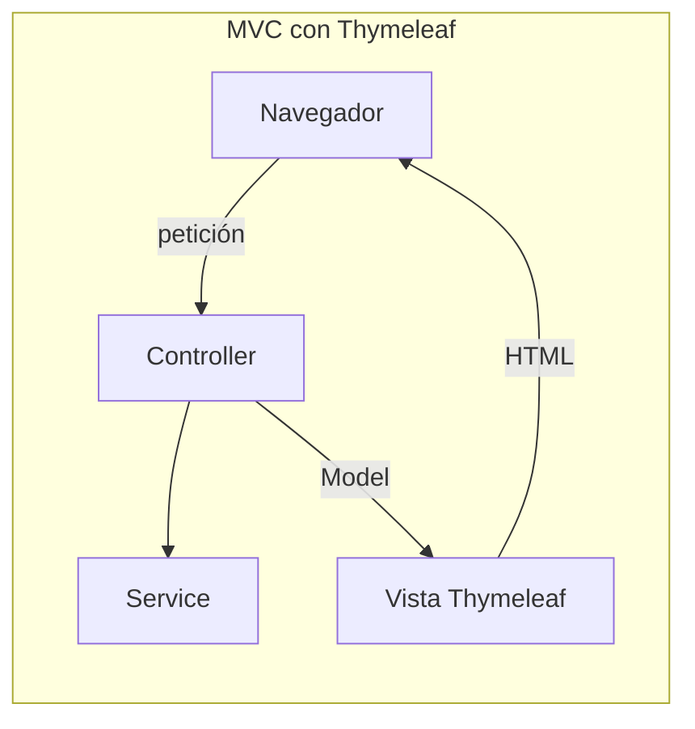
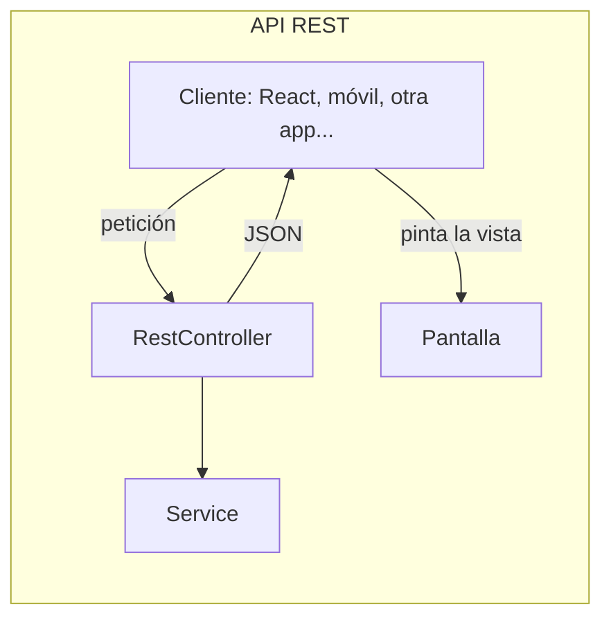

# De MVC a API REST: seguimos con Spring MVC

## 1. La idea en 30 segundos

Hasta ahora, nuestro servidor devolvía **páginas HTML** generadas con Thymeleaf. Con una API REST, el servidor devuelve **datos en JSON** y es otro programa (una app web en React, una app móvil, otra aplicación Spring...) quien decide cómo mostrarlos.

Lo importante: **no cambiamos de framework**. Seguimos con Spring MVC, con las mismas capas y las mismas anotaciones. Solo cambia lo que devuelve el controlador.

| | MVC con Thymeleaf | API REST |
|---|---|---|
| El controlador devuelve | El nombre de una vista: `"libros/lista"` | Los datos: un objeto o una lista |
| Los datos viajan en | El `Model` (`model.addAttribute`) | El cuerpo de la respuesta HTTP |
| Formato de la respuesta | HTML | JSON |
| Quién pinta la pantalla | El servidor (Thymeleaf) | El cliente |

## 2. ¿Dónde está la V del MVC?

En una API REST, el servidor **no tiene vista**: solo tiene el modelo y el controlador. La vista no desaparece, **se va al cliente**.





## 3. Qué se queda igual

Todo lo que hay por debajo del controlador **no se toca**:

```
es.daw.bibliotecajdbc
├── controller   → LibroController          (vistas Thymeleaf)
│                  LibroRestController      ← NUEVO: devuelve JSON
├── service      → LibroService             (sin cambios)
├── repository   → LibroRepository / Jdbc   (sin cambios)
├── model        → Libro, Autor             (sin cambios)
└── dto          → LibroDto                 (formularios)
                   LibroResponse            ← NUEVO: record para la API
```

Si la arquitectura por capas está bien hecha, **añadir una API es añadir un controlador**. Es el principio abierto/cerrado de SOLID en la práctica: ampliamos sin modificar lo que ya funciona.

## 4. Mismo caso, dos controladores

### Antes: `@Controller` con Thymeleaf

```java
@Controller
@RequestMapping("/libros")
@RequiredArgsConstructor
public class LibroController {

    private final LibroService libroService;
    private final LibroMapper libroMapper;

    @GetMapping("/editar/{isbn}")
    public String editar(@PathVariable String isbn, Model model) {
        Libro libro = libroService.buscarPorIsbn(isbn);
        model.addAttribute("libroDto", libroMapper.toDto(libro));
        return "libros/formulario";          // ← nombre de la vista
    }
}
```

### Ahora: `@RestController`

```java
@RestController
@RequestMapping("/api/libros")
@RequiredArgsConstructor
public class LibroRestController {

    private final LibroService libroService;

    @GetMapping
    public List<LibroResponse> listar() {
        return libroService.buscar(null, null, null).stream()
                .map(LibroResponse::from)
                .toList();                    // ← los datos, no una vista
    }

    @GetMapping("/{isbn}")
    public LibroResponse buscar(@PathVariable String isbn) {
        return LibroResponse.from(libroService.buscarPorIsbn(isbn));
    }
}
```

Fíjate en lo que **no** cambia: la inyección por constructor, `@RequestMapping`, `@GetMapping`, `@PathVariable` y el servicio son exactamente los mismos.

### ¿Qué es `@RestController`?

```java
@RestController  =  @Controller  +  @ResponseBody
```

`@ResponseBody` le dice a Spring: *"lo que devuelvo no es el nombre de una vista, es el cuerpo de la respuesta"*. Spring convierte el objeto a JSON automáticamente con **Jackson**, que ya viene incluido en el starter web.

## 5. El DTO de la API: un `record`

Para los formularios usamos clases con Lombok, porque Thymeleaf necesita un objeto vacío y setters. En la API usamos **`record`**: son inmutables, más cortos y Jackson los convierte a JSON sin problemas.

```java
public record LibroResponse(
        String isbn,
        String titulo,
        String autor,
        LocalDate fechaPublicacion) {

    public static LibroResponse from(Libro libro) {
        return new LibroResponse(
                libro.getIsbn(),
                libro.getTitulo(),
                libro.getAutor().getNombre(),
                libro.getFechaPublicacion());
    }
}
```

Respuesta de `GET /api/libros/9788490000847`:

```json
{
  "isbn": "9788490000847",
  "titulo": "Cien años de soledad",
  "autor": "Gabriel García Márquez",
  "fechaPublicacion": "1967-05-30"
}
```

> Igual que en MVC, **nunca devolvemos el modelo** (`Libro`) directamente: el DTO decide qué datos se publican. Por ejemplo, el `id` interno no sale nunca.

## 6. Códigos de estado: `ResponseEntity`

En MVC, si algo salía bien, se mostraba una página y listo. En una API, el cliente es un programa y necesita saber **qué ha pasado** mediante el código de estado HTTP. Para controlarlo usamos `ResponseEntity`:

```java
@DeleteMapping("/{isbn}")
public ResponseEntity<Void> borrar(@PathVariable String isbn) {
    libroService.borrar(isbn);
    return ResponseEntity.noContent().build();       // 204 No Content
}
```

| Operación | Método | Código si va bien |
|---|---|---|
| Listar o consultar | `GET` | 200 OK |
| Crear | `POST` | 201 Created |
| Actualizar | `PUT` | 200 OK o 204 No Content |
| Borrar | `DELETE` | 204 No Content |

Si un método devuelve directamente el objeto (como `listar()`), Spring responde con 200 OK.

## 7. Primera sorpresa: los errores siguen devolviendo HTML

Prueba `GET /api/libros/0000000000000` (un ISBN que no existe). El servicio lanza `RecursoNoEncontradoException` y nuestro `GlobalExceptionHandler` la captura... **y devuelve la página `error.html`**.

¿Por qué? Porque es un `@ControllerAdvice` pensado para MVC: devuelve el nombre de una vista. A un cliente que espera JSON, una página HTML no le sirve.

**Pregunta para pensar:** ¿cómo harías que, para las rutas `/api/**`, el error llegue como JSON con un 404? Lo resolveremos con `@RestControllerAdvice` y `ProblemDetail` (regla 7 de [API-REST.md](API-REST.md)).

## 8. ¿Cómo lo pruebo?

Ya no hay formularios ni enlaces. Para probar la API:

| Herramienta | Para qué |
|---|---|
| Navegador | Solo peticiones `GET` (escribe la URL y verás el JSON) |
| Cliente HTTP de IntelliJ (fichero `.http`) | Todos los métodos, desde el propio proyecto |
| Postman | Todos los métodos, guardando colecciones de peticiones |

Ejemplo de fichero `libros.http` en IntelliJ:

```http
### Listar libros
GET http://localhost:8080/api/libros

### Consultar un libro
GET http://localhost:8080/api/libros/9788490000847

### Borrar un libro
DELETE http://localhost:8080/api/libros/9788490000847
```

> **Ojo con la seguridad:** si el proyecto tiene Spring Security con `formLogin`, las peticiones a `/api/**` desde Postman o el fichero `.http` recibirán la página de login o un 403 por CSRF. Es normal: una API no usa sesión ni formulario de login. Lo resolveremos con **[JWT](JWT.md)**.

## 9. Resumen

- Seguimos con **Spring MVC**: mismas capas, mismas anotaciones.
- `@RestController` = `@Controller` + `@ResponseBody`: devuelve datos, no vistas.
- Jackson convierte los objetos a **JSON** automáticamente.
- DTO de la API como **`record`**; nunca se devuelve el modelo.
- Los **códigos de estado** comunican el resultado: `ResponseEntity`.
- La vista ahora la pone **el cliente**.

## Siguientes pasos

1. [Reglas de diseño de una API REST](API-REST.md): URLs por recursos, métodos HTTP, códigos de estado, errores...
2. Errores en JSON con `@RestControllerAdvice` y `ProblemDetail`.
3. Documentación con Swagger/OpenAPI.
4. [Autenticación sin estado con JWT](JWT.md).
