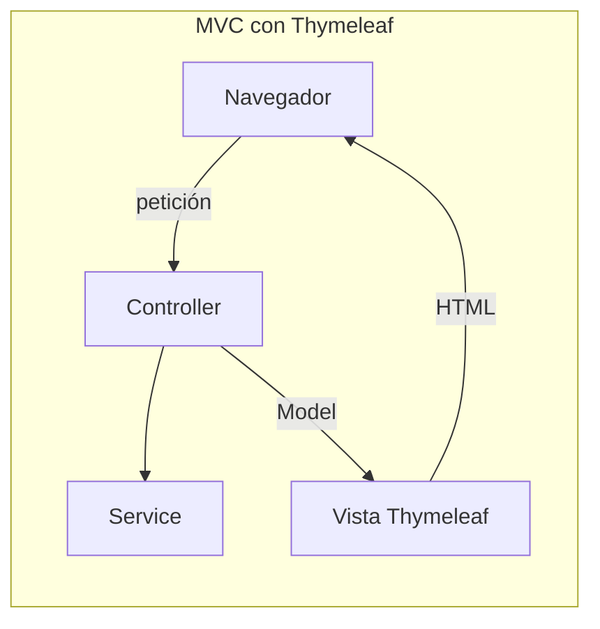
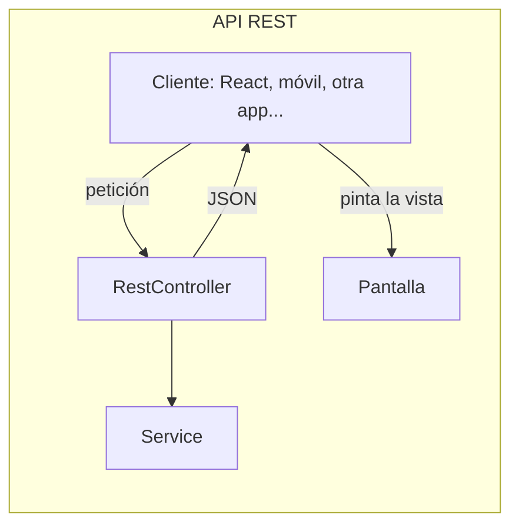

# De MVC a API REST: seguimos con Spring MVC

## 1. La idea en 30 segundos

Hasta ahora, nuestro servidor devolvía **páginas HTML** generadas con Thymeleaf. Con una API REST, el servidor devuelve **datos en JSON** y es otro programa (una app web en React, una app móvil, otra aplicación Spring...) quien decide cómo mostrarlos.

Lo importante: **no cambiamos de framework**. Seguimos con Spring MVC, con las mismas capas y las mismas anotaciones. Lo que cambia es **lo que entra y sale del controlador**.

| | MVC con Thymeleaf | API REST |
|---|---|---|
| El controlador devuelve | El nombre de una vista: `"productos/lista"` | Los datos: un objeto o una lista |
| Los datos salen en | El `Model` (`model.addAttribute`) | El cuerpo de la respuesta HTTP |
| Los datos entran desde | Un formulario HTML | El cuerpo de la petición, en JSON |
| Formato de la respuesta | HTML | JSON |
| Quién pinta la pantalla | El servidor (Thymeleaf) | El cliente |

> En estos apuntes usamos `Producto` como ejemplo. Es solo para ilustrar: en la práctica guiada trabajaremos con otro modelo.

## 2. ¿Dónde está la V del MVC?

En una API REST, el servidor **no tiene vista**: solo tiene el modelo y el controlador. La vista no desaparece, **se va al cliente**.





## 3. Qué se queda igual y qué cambia

```
controller   → ProductoController        @Controller      →  ProductoRestController  @RestController
service      → ProductoService           sin cambios
repository   → ProductoRepository        sin cambios en la idea (interfaz + implementación)
model        → Producto                  sin cambios
dto          → ProductoDto (Lombok)      formularios      →  ProductoRequest / ProductoResponse (record)
mapper       → ProductoMapper            toDto / toModelEntity, igual que siempre
templates/   → vistas Thymeleaf          desaparecen
```

Si la arquitectura por capas está bien hecha, **pasar a una API solo toca el controlador y los DTO**. El servicio no sabe si quien le llama pinta HTML o devuelve JSON. Es el principio abierto/cerrado de SOLID en la práctica.

## 4. Mismo caso, dos controladores

### Antes: `@Controller` con Thymeleaf

```java
@Controller
@RequestMapping("/productos")
@RequiredArgsConstructor
public class ProductoController {

    private final ProductoService productoService;
    private final ProductoMapper productoMapper;

    @GetMapping("/editar/{id}")
    public String editar(@PathVariable Long id, Model model) {
        Producto producto = productoService.buscarPorId(id);
        model.addAttribute("productoDto", productoMapper.toDto(producto));
        return "productos/formulario";          // ← nombre de la vista
    }
}
```

### Ahora: `@RestController`

```java
@RestController
@RequestMapping("/api/productos")
@RequiredArgsConstructor
public class ProductoRestController {

    private final ProductoService productoService;
    private final ProductoMapper productoMapper;

    @GetMapping
    public List<ProductoResponse> listar() {
        List<ProductoResponse> respuesta = new ArrayList<>();
        for (Producto producto : productoService.listar()) {
            respuesta.add(productoMapper.toDto(producto));
        }
        return respuesta;                        // ← los datos, no una vista
    }

    @GetMapping("/{id}")
    public ProductoResponse buscar(@PathVariable Long id) {
        return productoMapper.toDto(productoService.buscarPorId(id));
    }
}
```

Fíjate en lo que **no** cambia: la inyección por constructor, `@RequestMapping`, `@GetMapping`, `@PathVariable`, el servicio y el mapper.

Fíjate también en las URLs: en MVC eran **acciones** (`/productos/editar/5`); en una API son **recursos** (`/api/productos/5`) y la acción la indica el método HTTP. Lo vemos en la regla 3 de [API-REST.md](API-REST.md).

### ¿Qué es `@RestController`?

```java
@RestController  =  @Controller  +  @ResponseBody
```

`@ResponseBody` le dice a Spring: *"lo que devuelvo no es el nombre de una vista, es el cuerpo de la respuesta"*. Spring convierte el objeto a JSON automáticamente con **Jackson**, que ya viene incluido en el starter web.

## 5. Recibir datos: de formulario a JSON

En MVC los datos llegaban de un formulario HTML. En una API llegan en el **cuerpo de la petición** en JSON, y Jackson hace el camino contrario: de JSON a objeto.

| | MVC con Thymeleaf | API REST |
|---|---|---|
| Qué envía el cliente | Campos de formulario (`nombre=Teclado&precio=25`) | Un JSON (`{"nombre": "Teclado", "precio": 25}`) |
| Cómo lo recibe el controlador | `@ModelAttribute ProductoDto` (o sin anotar) | `@RequestBody ProductoRequest` |
| Validación | `@Valid` + `BindingResult` y se vuelve al formulario | `@Valid` y, si falla, un **400 Bad Request** |

```java
@PostMapping
public ResponseEntity<ProductoResponse> crear(@Valid @RequestBody ProductoRequest request) {
    Producto creado = productoService.crear(productoMapper.toModelEntity(request));
    return ResponseEntity.status(HttpStatus.CREATED).body(productoMapper.toDto(creado));
}
```

> Sin `@RequestBody`, Spring busca los datos como si vinieran de un formulario y el objeto llega con todos los campos a `null`. Es uno de los errores más habituales.

## 6. Los DTO de la API: `record`

Para los formularios usamos clases con Lombok, porque Thymeleaf necesita un objeto vacío y setters. En la API usamos **`record`**: son inmutables, más cortos y Jackson los convierte a JSON y desde JSON sin problemas.

Normalmente separamos **lo que entra** de **lo que sale**:

```java
public record ProductoRequest(
        @NotBlank String nombre,
        @Positive BigDecimal precio) {
}

public record ProductoResponse(
        Long id,
        String nombre,
        BigDecimal precio,
        String categoria) {
}
```

- El `id` no viene en el `ProductoRequest`: lo genera la base de datos.
- `ProductoResponse` decide qué se publica: puede aplanar datos (`categoria` como texto en vez de un objeto) y ocultar otros.

El mapper sigue siendo un componente con `toDto` y `toModelEntity`, como en MVC:

```java
@Component
public class ProductoMapper {

    public ProductoResponse toDto(Producto producto) {
        return new ProductoResponse(
                producto.getId(),
                producto.getNombre(),
                producto.getPrecio(),
                producto.getCategoria().getNombre());
    }

    public Producto toModelEntity(ProductoRequest request) {
        return Producto.builder()
                .nombre(request.nombre())
                .precio(request.precio())
                .build();
    }
}
```

> Igual que en MVC, **nunca devolvemos el modelo** (`Producto`) directamente: el DTO decide qué datos se publican. Con JPA veremos además que devolver una entidad puede provocar errores al convertirla a JSON.

## 7. Códigos de estado: `ResponseEntity`

En MVC, si algo salía bien, se mostraba una página y listo. En una API, el cliente es un programa y necesita saber **qué ha pasado** mediante el código de estado HTTP. Para controlarlo usamos `ResponseEntity`:

```java
@DeleteMapping("/{id}")
public ResponseEntity<Void> borrar(@PathVariable Long id) {
    productoService.borrar(id);
    return ResponseEntity.noContent().build();       // 204 No Content
}
```

| Operación | Método | URL | Código si va bien |
|---|---|---|---|
| Listar | `GET` | `/api/productos` | 200 OK |
| Consultar uno | `GET` | `/api/productos/{id}` | 200 OK |
| Crear | `POST` | `/api/productos` | 201 Created |
| Actualizar | `PUT` | `/api/productos/{id}` | 200 OK |
| Borrar | `DELETE` | `/api/productos/{id}` | 204 No Content |

Si un método devuelve directamente el objeto (como `listar()`), Spring responde con 200 OK.

## 8. Primera sorpresa: ¿y los errores?

Prueba `GET /api/productos/999` (un id que no existe). El servicio lanza `RecursoNoEncontradoException`... y la API responde con un **500 Internal Server Error**:

```json
{
  "timestamp": "2026-12-01T10:15:30.000+00:00",
  "status": 500,
  "error": "Internal Server Error",
  "path": "/api/productos/999"
}
```

Dos problemas:

- **El código es incorrecto.** No es un fallo del servidor: el recurso no existe, así que debería ser un **404**.
- **El cliente no sabe qué ha pasado.** El mensaje de la excepción no aparece por ningún sitio.

Y si abres la misma URL en el navegador, verás la página *Whitelabel Error Page* en HTML. Spring mira la cabecera `Accept` de la petición: el navegador pide HTML y Postman acepta JSON.

En MVC esto lo resolvíamos con un `@ControllerAdvice` que devolvía la vista `error`. En una API no hay vistas.

**Pregunta para pensar:** ¿cómo harías que el error llegue como JSON, con un 404 y un mensaje claro? Lo resolveremos con `@RestControllerAdvice` y `ProblemDetail` (regla 7 de [API-REST.md](API-REST.md)).

## 9. ¿Cómo lo pruebo?

Ya no hay formularios ni enlaces. Para probar la API:

| Herramienta | Para qué |
|---|---|
| Navegador | Solo peticiones `GET` (escribe la URL y verás el JSON) |
| Cliente HTTP de IntelliJ (fichero `.http`) | Todos los métodos, desde el propio proyecto |
| Postman | Todos los métodos, guardando colecciones de peticiones |

Ejemplo de fichero `productos.http` en IntelliJ:

```http
### Listar productos
GET http://localhost:8080/api/productos

### Consultar un producto
GET http://localhost:8080/api/productos/1

### Crear un producto
POST http://localhost:8080/api/productos
Content-Type: application/json

{
  "nombre": "Teclado",
  "precio": 25.50
}

### Borrar un producto
DELETE http://localhost:8080/api/productos/1
```

> **Ojo con la seguridad:** en MVC protegíamos la aplicación con `formLogin`, sesión y CSRF. Nada de eso sirve para una API: Postman no rellena formularios de login ni guarda la sesión. Una API se protege con un token: lo veremos con **[JWT](JWT.md)**.

## 10. Resumen

- Seguimos con **Spring MVC**: mismas capas, mismas anotaciones.
- `@RestController` = `@Controller` + `@ResponseBody`: devuelve datos, no vistas.
- Los datos entran con `@RequestBody` y salen como JSON gracias a **Jackson**.
- DTO de la API como **`record`**, separando petición y respuesta; nunca se devuelve el modelo.
- URLs por **recursos**; la acción la indica el **método HTTP**.
- Los **códigos de estado** comunican el resultado: `ResponseEntity`.
- La vista ahora la pone **el cliente**.

## Siguientes pasos

1. [Reglas de diseño de una API REST](API-REST.md): URLs por recursos, métodos HTTP, códigos de estado, errores...
2. [Autenticación sin estado con JWT](JWT.md).
3. Práctica guiada: una API REST con JPA que irá creciendo.

