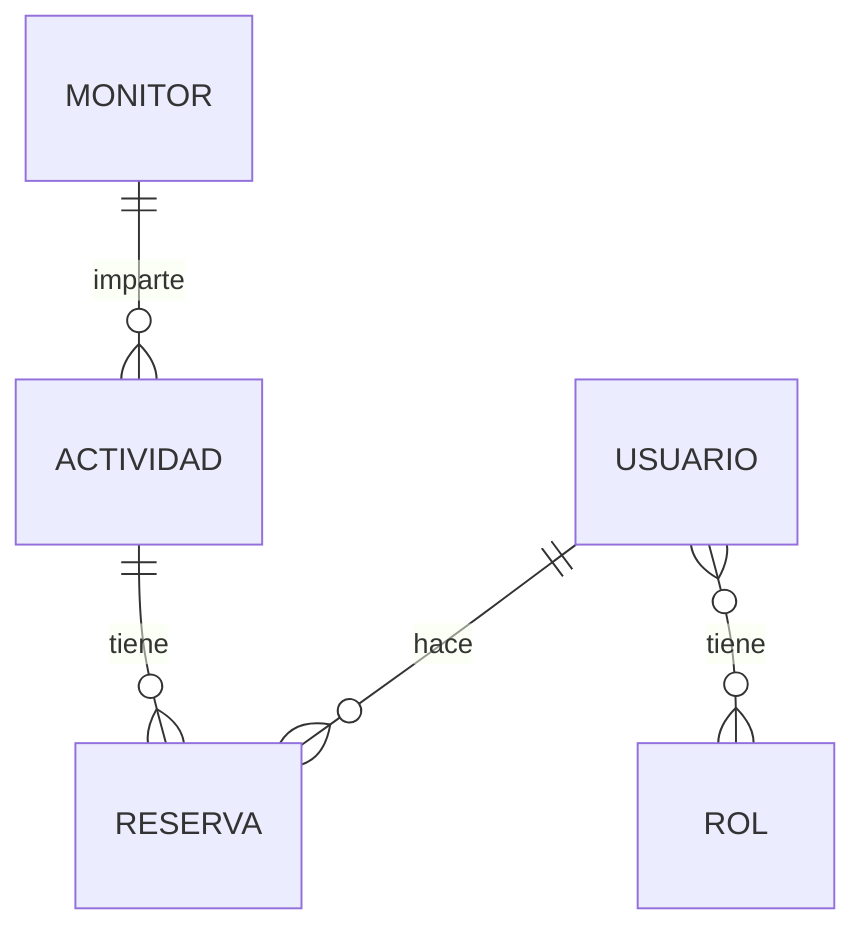
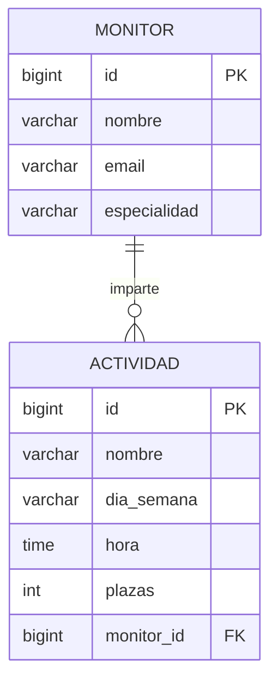
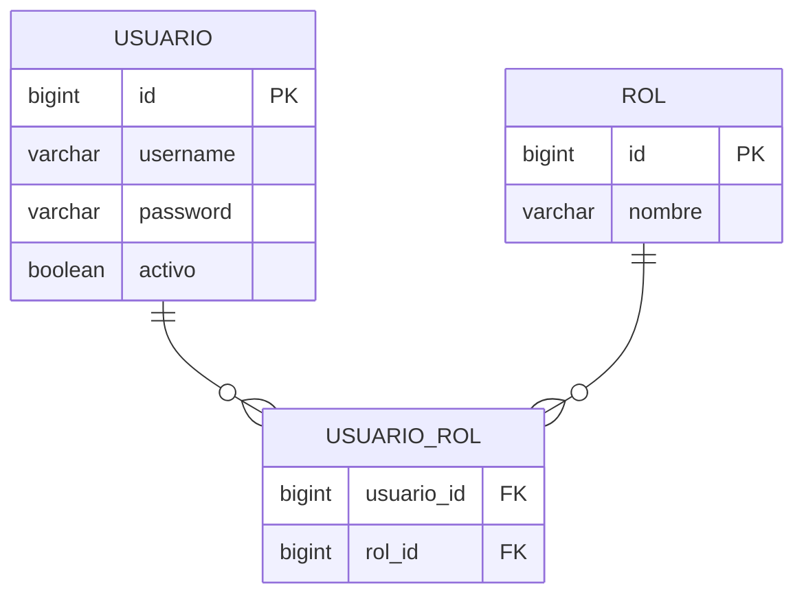

# Práctica guiada: API REST de un gimnasio con JPA

Vamos a construir desde cero la API REST de un gimnasio. El proyecto **irá creciendo**: en cada paso añadimos un concepto nuevo de JPA o de API REST, y solo uno cada vez.

Antes de empezar, lee [De MVC a API REST](../conceptos/de-mvc-a-api-rest.md).

## Guion de la práctica

| Paso | JPA | API REST |
|---|---|---|
| 0 | Proyecto con Spring Data JPA y H2 | — |
| 1 | Entidades y relación **1:N**: Monitor → Actividad | — |
| 2 | Relación **N:M**: Usuario ↔ Rol | — |
| 3 | `JpaRepository` | Primeros `GET`, DTO `record` y la sorpresa de devolver una entidad |
| 4 | Guardar, actualizar y borrar | `POST`, `PUT`, `DELETE`, `@RequestBody`, `@Valid`, `ResponseEntity` |
| 5 | — | Errores con `@RestControllerAdvice` y `ProblemDetail` |
| 6 | Tests de repositorio | Tests del controlador con MockMvc |
| 7 | Consultas derivadas y `@Query` | Filtros con `@RequestParam`, paginación y ordenación |
| 8 | Carga perezosa a fondo: `LazyInitializationException`, `@Transactional`, `JOIN FETCH`, problema N+1 | — |
| 9 | **N:M con atributos**: Reserva (entidad intermedia) | Reglas de negocio: "la actividad está llena" (409) |
| 10 | Usuarios y roles desde la BD | Seguridad con **JWT**: login, roles y "mis reservas" |
| 11 | — | Documentación con Swagger/OpenAPI |
| 12 | De H2 a **MySQL con Docker Compose** sin tocar el código | — |

El modelo completo al final de la práctica:



En los pasos 0 a 3 trabajamos con todo menos `RESERVA`, que llega en el paso 9.

---

## Paso 0. Crear el proyecto

Crea el proyecto con Spring Initializr desde IntelliJ:

| Campo | Valor |
|---|---|
| Name / Artifact | `gimnasio-api` |
| Group | `es.daw` |
| Package name | `es.daw.gimnasio` |
| Java | 25 |
| Spring Boot | 4.1.x |

Dependencias: **Spring Web**, **Spring Data JPA**, **H2 Database**, **Validation** y **Lombok**.

Comprueba que en el `pom.xml` está la consola de H2. Desde Spring Boot 4 es un módulo aparte:

```xml
<dependency>
    <groupId>org.springframework.boot</groupId>
    <artifactId>spring-boot-h2console</artifactId>
</dependency>
```

`application.properties`:

```properties
spring.application.name=gimnasio-api

# H2 en memoria
spring.datasource.url=jdbc:h2:mem:gimnasio
spring.h2.console.enabled=true

# JPA
spring.jpa.hibernate.ddl-auto=create-drop
spring.jpa.show-sql=true
spring.jpa.properties.hibernate.format_sql=true

# Ejecutar data.sql después de que Hibernate cree las tablas
spring.jpa.defer-datasource-initialization=true
```

| Propiedad | Qué hace |
|---|---|
| `ddl-auto=create-drop` | Hibernate **crea las tablas a partir de las entidades** al arrancar y las borra al parar. Ya no escribimos `schema.sql`. |
| `show-sql` y `format_sql` | Muestran en consola el SQL que genera Hibernate. Lo vamos a mirar mucho. |
| `defer-datasource-initialization` | Sin ella, Spring ejecuta `data.sql` **antes** de que existan las tablas y falla. |

> **JDBC frente a JPA.** Con JDBC escribíamos nosotros las tablas (`schema.sql`) y cada consulta SQL. Con JPA describimos las clases y Hibernate genera las tablas y el SQL. Nosotros pensamos en **objetos**; Hibernate traduce a **tablas**.

Estructura de paquetes:
```
es.daw.gimnasio
├── controller
├── service
├── repository
├── entity   ← antes model
├── dto
├── mapper
└── exception
```

> Con JDBC, nuestras clases de datos eran POJOs en `model`. Con JPA son **entidades** (`@Entity`): Hibernate las vincula a una tabla y gestiona su ciclo de vida. Por eso el paquete pasa a llamarse `entity`.
---

## Paso 1. Relación 1:N: Monitor → Actividad

Un monitor imparte muchas actividades; cada actividad la imparte un monitor.



### 1.1. El enum `DiaSemana`

```java
public enum DiaSemana {
    LUNES, MARTES, MIERCOLES, JUEVES, VIERNES, SABADO, DOMINGO
}
```

### 1.2. La entidad `Actividad`: el lado "muchos"

```java
@Entity
@Table(name = "actividad")
@Getter
@Setter
@NoArgsConstructor
@AllArgsConstructor
@Builder
public class Actividad {

    @Id
    @GeneratedValue(strategy = GenerationType.IDENTITY)
    private Long id;

    @Column(nullable = false, length = 100)
    private String nombre;

    @Enumerated(EnumType.STRING)
    @Column(nullable = false, length = 10)
    private DiaSemana diaSemana;

    @Column(nullable = false)
    private LocalTime hora;

    @Column(nullable = false)
    private Integer plazas;

    @ManyToOne(fetch = FetchType.LAZY, optional = false)
    @JoinColumn(name = "monitor_id")
    private Monitor monitor;
}
```

| Anotación | Qué hace |
|---|---|
| `@Entity` | Esta clase se guarda en una tabla. |
| `@Id` + `@GeneratedValue(IDENTITY)` | Clave primaria autoincremental: la genera la base de datos. |
| `@Column` | Restricciones de la columna (`NOT NULL`, longitud...). Es opcional: sin ella, el campo se guarda igualmente. |
| `@Enumerated(EnumType.STRING)` | Guarda el enum como texto (`'LUNES'`). Sin él se guarda su posición (0, 1, 2...) y, si algún día cambias el orden del enum, los datos dejan de tener sentido. |
| `@ManyToOne` | Muchas actividades → un monitor. En la tabla se convierte en la **clave ajena**. |
| `@JoinColumn(name = "monitor_id")` | Nombre de la columna de la clave ajena. |

> Spring Boot convierte automáticamente los nombres de Java a SQL: el campo `diaSemana` se convierte en la columna `dia_semana`.

### 1.3. La entidad `Monitor`: el lado "uno"

```java
@Entity
@Table(name = "monitor")
@Getter
@Setter
@NoArgsConstructor
@AllArgsConstructor
@Builder
public class Monitor {

    @Id
    @GeneratedValue(strategy = GenerationType.IDENTITY)
    private Long id;

    @Column(nullable = false, length = 100)
    private String nombre;

    @Column(nullable = false, unique = true, length = 100)
    private String email;

    @Column(length = 50)
    private String especialidad;

    @OneToMany(mappedBy = "monitor")
    @Builder.Default
    private List<Actividad> actividades = new ArrayList<>();
}
```

- `@OneToMany(mappedBy = "monitor")`: un monitor → muchas actividades. `mappedBy` dice: *"la clave ajena no está en mi tabla; búscala en el atributo `monitor` de `Actividad`"*.
- `@Builder.Default`: sin él, `Monitor.builder().build()` deja la lista a `null` en vez de vacía.

**¿Quién manda en la relación?** En una 1:N, la clave ajena está en la tabla de los "muchos". Por eso `Actividad` es el **lado propietario** (el que tiene `@JoinColumn`) y `Monitor` es el **lado inverso** (el que tiene `mappedBy`).

| | `Actividad` (propietario) | `Monitor` (inverso) |
|---|---|---|
| Anotación | `@ManyToOne` + `@JoinColumn` | `@OneToMany(mappedBy = ...)` |
| En la tabla | Tiene la columna `monitor_id` | No tiene ninguna columna para la relación |
| ¿Es obligatorio? | Sí | No: solo si queremos navegar de monitor a actividades |

> **¿Por qué no `@Data`?** `@Data` genera `toString()`, `equals()` y `hashCode()` con **todos** los atributos. `Monitor.toString()` llamaría al `toString()` de sus actividades, que llamarían al de su monitor, que llamaría... hasta un `StackOverflowError`. En las entidades usamos `@Getter` y `@Setter`.

### 1.4. Arranca y mira la consola

Arranca la aplicación y busca en la consola el SQL que ha generado Hibernate. Verás algo así:

```sql
create table actividad (
    id bigint generated by default as identity,
    nombre varchar(100) not null,
    dia_semana varchar(10) not null,
    hora time not null,
    plazas integer not null,
    monitor_id bigint not null,
    primary key (id)
)
...
alter table if exists actividad
   add constraint FK...
   foreign key (monitor_id)
   references monitor
```

**Pregunta:** ¿en qué tabla está la clave ajena? ¿Coincide con lo que dice la tabla del lado propietario?

### 1.5. Datos de prueba: `data.sql`

Crea `src/main/resources/data.sql`:

```sql
INSERT INTO monitor (nombre, email, especialidad) VALUES ('Laura Gómez', 'laura@gimnasio.es', 'Yoga y pilates');
INSERT INTO monitor (nombre, email, especialidad) VALUES ('Carlos Ruiz', 'carlos@gimnasio.es', 'Ciclo indoor');
INSERT INTO monitor (nombre, email, especialidad) VALUES ('Marta Díaz', 'marta@gimnasio.es', 'Entrenamiento funcional');
INSERT INTO monitor (nombre, email, especialidad) VALUES ('Javier Sanz', 'javier@gimnasio.es', 'Natación');

INSERT INTO actividad (nombre, dia_semana, hora, plazas, monitor_id) VALUES ('Yoga', 'LUNES', '09:00', 15, 1);
INSERT INTO actividad (nombre, dia_semana, hora, plazas, monitor_id) VALUES ('Pilates', 'MIERCOLES', '18:00', 12, 1);
INSERT INTO actividad (nombre, dia_semana, hora, plazas, monitor_id) VALUES ('Spinning', 'MARTES', '19:00', 20, 2);
INSERT INTO actividad (nombre, dia_semana, hora, plazas, monitor_id) VALUES ('Spinning', 'JUEVES', '19:00', 20, 2);
INSERT INTO actividad (nombre, dia_semana, hora, plazas, monitor_id) VALUES ('Funcional', 'LUNES', '20:00', 10, 3);
INSERT INTO actividad (nombre, dia_semana, hora, plazas, monitor_id) VALUES ('Crossfit', 'VIERNES', '18:30', 8, 3);
```

> **No escribimos los `id`.** Los genera la base de datos (1, 2, 3...) en el orden de los `INSERT`. Si los pusiéramos a mano, H2 no actualizaría su contador y el primer `POST` de la API fallaría con una clave duplicada.

Javier Sanz no tiene actividades a propósito: lo usaremos cuando hagamos consultas.

### 1.6. Comprueba en la consola de H2

Abre http://localhost:8080/h2-console con la URL `jdbc:h2:mem:gimnasio`, usuario `sa` y contraseña vacía.

```sql
SELECT m.nombre, a.nombre, a.dia_semana, a.hora
FROM monitor m LEFT JOIN actividad a ON a.monitor_id = m.id;
```

---

## Paso 2. Relación N:M: Usuario ↔ Rol

Un usuario puede tener varios roles (el administrador también es usuario normal) y un rol lo tienen muchos usuarios. En la base de datos, una N:M necesita una **tabla intermedia**.



En Java **no creamos una clase para `usuario_rol`**: es una tabla técnica sin datos propios. JPA la gestiona sola.

### 2.1. La entidad `Rol`

```java
@Entity
@Table(name = "rol")
@Getter
@Setter
@NoArgsConstructor
@AllArgsConstructor
@Builder
public class Rol {

    @Id
    @GeneratedValue(strategy = GenerationType.IDENTITY)
    private Long id;

    @Column(nullable = false, unique = true, length = 20)
    private String nombre;
}
```

`Rol` no sabe qué usuarios lo tienen: la relación es **unidireccional**. Nunca vamos a necesitar "dame los usuarios del rol ADMIN" desde Java, así que no añadimos esa lista.

### 2.2. La entidad `Usuario`

```java
@Entity
@Table(name = "usuario")
@Getter
@Setter
@NoArgsConstructor
@AllArgsConstructor
@Builder
public class Usuario {

    @Id
    @GeneratedValue(strategy = GenerationType.IDENTITY)
    private Long id;

    @Column(nullable = false, unique = true, length = 50)
    private String username;

    @Column(nullable = false, length = 60)
    private String password;

    @Column(nullable = false)
    private boolean activo;

    @ManyToMany(fetch = FetchType.EAGER)
    @JoinTable(
            name = "usuario_rol",
            joinColumns = @JoinColumn(name = "usuario_id"),
            inverseJoinColumns = @JoinColumn(name = "rol_id"))
    @Builder.Default
    private Set<Rol> roles = new HashSet<>();
}
```

| Elemento | Qué hace |
|---|---|
| `@ManyToMany` | Muchos usuarios ↔ muchos roles. |
| `@JoinTable(name = "usuario_rol")` | Nombre de la tabla intermedia. |
| `joinColumns` | Columna que apunta a **esta** entidad (`usuario_id`). |
| `inverseJoinColumns` | Columna que apunta a **la otra** entidad (`rol_id`). |
| `Set` en vez de `List` | Un usuario no puede tener el mismo rol dos veces. |
| `fetch = FetchType.EAGER` | Al cargar un usuario se cargan **siempre** sus roles. Lo explicamos ahora. |

> Como `Usuario` tiene `@JoinTable`, es el **lado propietario** de la relación: para darle un rol a un usuario, se añade el rol a `usuario.getRoles()`.

> `password` mide 60 porque guardaremos la contraseña cifrada con **BCrypt**, como en la práctica de Spring Security.

### 2.3. `LAZY` frente a `EAGER`

Cuando JPA carga una entidad, ¿carga también las relacionadas?

| | `LAZY` (perezosa) | `EAGER` (inmediata) |
|---|---|---|
| Cuándo carga la relación | Solo cuando se usa (`getActividades()`) | Siempre, junto con la entidad |
| Ventaja | No carga datos que no se usan | Los datos están siempre disponibles |
| Riesgo | `LazyInitializationException` si se usa fuera de la transacción (paso 8) | Cargar de más si la relación es grande |
| Por defecto en | `@OneToMany`, `@ManyToMany` | `@ManyToOne`, `@OneToOne` |

**Regla de clase:** por defecto, `LAZY`. Ponemos `EAGER` solo cuando la relación es pequeña y se necesita siempre:

- En `Actividad`, ponemos `LAZY` en el monitor aunque `@ManyToOne` sea `EAGER` por defecto: no siempre lo necesitamos.
- En `Usuario`, ponemos `EAGER` en los roles: son uno o dos, y cuando hagamos el login con JWT **siempre** los necesitaremos para saber qué puede hacer el usuario.

### 2.4. Datos de prueba

Añade al final de `data.sql`:

```sql
INSERT INTO rol (nombre) VALUES ('ADMIN');
INSERT INTO rol (nombre) VALUES ('USER');

-- Contraseña de los tres usuarios: 1234 (cifrada con BCrypt)
INSERT INTO usuario (username, password, activo) VALUES ('admin', '$2a$10$yDIgCIVCfk9/PHoHmNNEDeYDSXql0VTJFjktLD2y9sfoeIf8OWDj.', TRUE);
INSERT INTO usuario (username, password, activo) VALUES ('ana', '$2a$10$0xgT51Zd9YLkfscuYXNzzOOPCVK5sXr/jxCyAYUswWUsbm/jdnAnO', TRUE);
INSERT INTO usuario (username, password, activo) VALUES ('luis', '$2a$10$pvV5FaKUBTFlq7LAJDr4d.E/Glf5hriGEJfgoBQf1LxcmBkr1dgLS', FALSE);

-- admin tiene los dos roles; ana y luis, solo USER
INSERT INTO usuario_rol (usuario_id, rol_id) VALUES (1, 1);
INSERT INTO usuario_rol (usuario_id, rol_id) VALUES (1, 2);
INSERT INTO usuario_rol (usuario_id, rol_id) VALUES (2, 2);
INSERT INTO usuario_rol (usuario_id, rol_id) VALUES (3, 2);
```

Comprueba en la consola de H2 que Hibernate ha creado la tabla `usuario_rol` con su clave primaria compuesta y sus dos claves ajenas:

```sql
SELECT u.username, r.nombre
FROM usuario u
JOIN usuario_rol ur ON ur.usuario_id = u.id
JOIN rol r ON r.id = ur.rol_id;
```

**Pregunta:** ¿qué pasaría si `admin` necesitara guardar también **desde qué fecha** tiene el rol ADMIN? ¿Podría seguir sin una clase para la tabla intermedia? (Lo resolveremos en el paso 9, con las reservas.)

---

## Paso 3. Los primeros `GET` de la API

### 3.1. Repositorios: adiós a la implementación JDBC

Con JDBC teníamos una **interfaz** y una **implementación** con todo el SQL. Con Spring Data JPA solo escribimos la interfaz: **Spring genera la implementación al arrancar**.

```java
public interface MonitorRepository extends JpaRepository<Monitor, Long> {
}

public interface ActividadRepository extends JpaRepository<Actividad, Long> {
}

public interface UsuarioRepository extends JpaRepository<Usuario, Long> {

    Optional<Usuario> findByUsername(String username);
}
```

`JpaRepository<Monitor, Long>` (entidad y tipo del id) ya trae `findAll()`, `findById()`, `save()`, `deleteById()`, `existsById()`, `count()`...

`findByUsername` no tiene implementación: Spring **lee el nombre del método** y genera la consulta (`... WHERE username = ?`). Son las **consultas derivadas**, y las veremos a fondo en el paso 7.

| | JDBC (UT02) | Spring Data JPA |
|---|---|---|
| Qué escribimos | Interfaz + implementación con SQL | Solo la interfaz |
| CRUD básico | Lo programamos nosotros | Heredado de `JpaRepository` |
| Consultas sencillas | SQL a mano | Por el nombre del método |
| `GenericRepository<T, ID>` | Lo creamos nosotros | Es `JpaRepository<T, ID>` |

### 3.2. La excepción de recurso no encontrado

```java
public class RecursoNoEncontradoException extends RuntimeException {

    public RecursoNoEncontradoException(String mensaje) {
        super(mensaje);
    }
}
```

### 3.3. Servicios

```java
@Service
@RequiredArgsConstructor
public class ActividadService {

    private final ActividadRepository actividadRepository;

    public List<Actividad> listar() {
        return actividadRepository.findAll();
    }

    public Actividad buscarPorId(Long id) {
        return actividadRepository.findById(id)
                .orElseThrow(() -> new RecursoNoEncontradoException("No existe la actividad con id " + id));
    }
}

@Service
@RequiredArgsConstructor
public class MonitorService {

    private final MonitorRepository monitorRepository;

    public List<Monitor> listar() {
        return monitorRepository.findAll();
    }
}
```

> `findById` devuelve un `Optional`: puede que el id no exista. `orElseThrow` devuelve el objeto si existe y, si no, lanza la excepción.

### 3.4. Primera sorpresa: devolver la entidad

Vamos a hacerlo **mal a propósito**. Crea este controlador:

```java
@RestController
@RequestMapping("/api/monitores")
@RequiredArgsConstructor
public class MonitorRestController {

    private final MonitorService monitorService;

    @GetMapping
    public List<Monitor> listar() {          // ← devolvemos la entidad
        return monitorService.listar();
    }
}
```

Abre http://localhost:8080/api/monitores en el navegador.

**¿Qué ha pasado?** Fíjate en el JSON (si llega a mostrarse) y en el error de la consola: Jackson convierte el monitor, entra en `actividades`, convierte cada actividad, entra en su `monitor`, vuelve a entrar en `actividades`... Es una **recursión infinita**, el mismo problema que con `@Data` y `toString()`, pero ahora al generar el JSON.

Hay soluciones con anotaciones de Jackson (`@JsonIgnore`, `@JsonManagedReference`...), pero mezclan el JSON con la entidad. Nosotros ya tenemos la solución de verdad: **la API devuelve DTO, nunca entidades**.

### 3.5. Los DTO de respuesta

```java
public record ActividadResponse(
        Long id,
        String nombre,
        DiaSemana diaSemana,
        LocalTime hora,
        Integer plazas,
        String monitor) {
}

public record MonitorResponse(
        Long id,
        String nombre,
        String especialidad,
        int numActividades) {
}
```

El DTO corta la recursión: `ActividadResponse` lleva solo el **nombre** del monitor, y `MonitorResponse` lleva solo **cuántas** actividades tiene.

### 3.6. Mappers

```java
@Component
public class ActividadMapper {

    public ActividadResponse toDto(Actividad actividad) {
        return new ActividadResponse(
                actividad.getId(),
                actividad.getNombre(),
                actividad.getDiaSemana(),
                actividad.getHora(),
                actividad.getPlazas(),
                actividad.getMonitor().getNombre());
    }
}

@Component
public class MonitorMapper {

    public MonitorResponse toDto(Monitor monitor) {
        return new MonitorResponse(
                monitor.getId(),
                monitor.getNombre(),
                monitor.getEspecialidad(),
                monitor.getActividades().size());
    }
}
```

### 3.7. Controladores

Corrige `MonitorRestController` y crea `ActividadRestController`:

```java
@RestController
@RequestMapping("/api/monitores")
@RequiredArgsConstructor
public class MonitorRestController {

    private final MonitorService monitorService;
    private final MonitorMapper monitorMapper;

    @GetMapping
    public List<MonitorResponse> listar() {
        List<MonitorResponse> respuesta = new ArrayList<>();
        for (Monitor monitor : monitorService.listar()) {
            respuesta.add(monitorMapper.toDto(monitor));
        }
        return respuesta;
    }
}

@RestController
@RequestMapping("/api/actividades")
@RequiredArgsConstructor
public class ActividadRestController {

    private final ActividadService actividadService;
    private final ActividadMapper actividadMapper;

    @GetMapping
    public List<ActividadResponse> listar() {
        List<ActividadResponse> respuesta = new ArrayList<>();
        for (Actividad actividad : actividadService.listar()) {
            respuesta.add(actividadMapper.toDto(actividad));
        }
        return respuesta;
    }

    @GetMapping("/{id}")
    public ActividadResponse buscar(@PathVariable Long id) {
        return actividadMapper.toDto(actividadService.buscarPorId(id));
    }
}
```

### 3.8. Prueba con el fichero `.http`

Crea `gimnasio.http` en la raíz del proyecto:

```http
### Listar monitores
GET http://localhost:8080/api/monitores

### Listar actividades
GET http://localhost:8080/api/actividades

### Consultar una actividad
GET http://localhost:8080/api/actividades/1

### Actividad que no existe
GET http://localhost:8080/api/actividades/999
```

Respuesta esperada de `GET /api/actividades/1`:

```json
{
  "id": 1,
  "nombre": "Yoga",
  "diaSemana": "LUNES",
  "hora": "09:00:00",
  "plazas": 15,
  "monitor": "Laura Gómez"
}
```

La última petición devuelve un **500**: es la sorpresa del punto 8 de [De MVC a API REST](../conceptos/de-mvc-a-api-rest.md). La resolveremos en el paso 5.

### 3.9. Mira el SQL de `GET /api/monitores`

Lanza `GET /api/monitores` y cuenta las `select` que aparecen en la consola. **Apúntalo**: una para los monitores y... ¿cuántas más? ¿Por qué? Lo resolveremos en el paso 8 (es el famoso **problema N+1**).

### Retos del paso 3

1. Añade `GET /api/monitores/{id}`, que devuelva 500 de momento si el monitor no existe.
2. Añade `GET /api/monitores/{id}/actividades` con las actividades de un monitor. Fíjate en la URL: es un **subrecurso** (regla 3 de [API-REST.md](../conceptos/API-REST.md)). Pista: puedes añadir a `ActividadRepository` un método `List<Actividad> findByMonitorId(Long monitorId)`.
3. ¿Qué devuelve el reto anterior para Javier Sanz? ¿Y para un monitor que no existe? ¿Deberían ser iguales?

---

*Continúa en el paso 4: `POST`, `PUT` y `DELETE` de actividades.*

